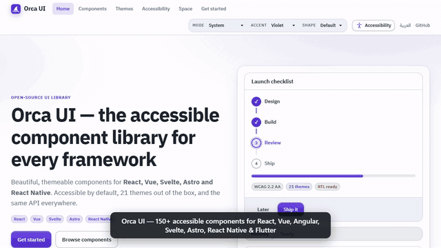

<div align="center">


# Orca UI

**Accessible, themeable UI components for every framework.**
React · Vue · Angular · Svelte · Astro · React Native · Flutter

WCAG 2.2 AA · 21 themes + your own brand colors · accessibility modes · charts · 3D · motion · sound · icons · RTL & Arabic · MIT

[**Live docs & demos**](https://oriebalzyuot96.github.io/orca-ui/) · [Components](https://oriebalzyuot96.github.io/orca-ui/components/) · [Themes](https://oriebalzyuot96.github.io/orca-ui/themes/) · [Accessibility modes](https://oriebalzyuot96.github.io/orca-ui/accessibility-modes/) · [Space builder](https://oriebalzyuot96.github.io/orca-ui/space/) · [العربية](https://oriebalzyuot96.github.io/orca-ui/ar/)

<a href="docs/media/orca-ui-demo.mp4"></a>

▶️ [Watch the full 75-second video](docs/media/orca-ui-demo.mp4)

</div>

---

## What is Orca UI?

Orca UI is one design system shipped as native packages for seven platforms. Every component has the same name, the same props and the same look in React, Vue, Angular, Svelte, Astro, React Native and Flutter — and accessibility is tested on every build, not just promised.

It covers everything PrimeNG-style libraries offer (forms, data, overlays, menus, media, feedback) and adds what most libraries don't: accessible charts, 3D, a motion engine, a UI sound engine, 239 original icons, 24 themeable illustrations, accessibility display modes, a theme generator for any brand color, and a drag-and-drop page builder.

## Install

```bash
npm i orca-ui            # everything in one package
# or: yarn add orca-ui · pnpm add orca-ui
```

```ts
import 'orca-ui/style.css';                       // once, in your app entry
import { Button, DataTable, swal } from 'orca-ui/react';
```

Framework packages (react, vue, @angular/*, svelte, astro, react-native, three) are optional peers — install only the one you use. Each target is also available as its own package:

| Package | Platform |
|---|---|
| `@orca-ui/react` | React 18 / 19 — the most complete set (180+ components and building blocks) |
| `@orca-ui/vue` | Vue 3 |
| `@orca-ui/angular` | Angular 20–22 (standalone, signals, reactive forms) |
| `@orca-ui/svelte` | Svelte 5 |
| `@orca-ui/astro` | Astro 5 (server-rendered, zero JS by default) |
| `@orca-ui/react-native` | React Native / Expo |
| `orca_ui` (pub.dev) | Flutter |
| `@orca-ui/three` | WebGL 3D components (three.js) |
| `@orca-ui/icons` | 239 original duotone icons for every framework |
| `@orca-ui/illustrations` | 24 themeable empty-state illustrations |
| `@orca-ui/core` | Tokens, CSS, theme engine, accessibility, motion and sound engines |

## Components

| Group | Components |
|---|---|
| **Forms** | Button, Input, Textarea, Select, Checkbox, Switch, RadioGroup, Slider, Segmented |
| **Advanced inputs** | AutoComplete, MultiSelect, Listbox, CascadeSelect, TreeSelect, DatePicker, InputNumber, InputMask, InputOtp, Password, Rating, Knob, ColorPicker (2D area, hue, alpha, HEX/RGB/HSL/OKLCH, eyedropper, contrast readout), ToggleButton, SelectButton, FloatLabel, InputGroup, KeyFilter |
| **Data** | DataTable (sort, loading skeletons, responsive cards), Tree, TreeTable, DataView, Paginator, VirtualScroller, OrderList, PickList, OrganizationChart, Timeline |
| **Panels & layout** | Card, Accordion, Tabs, Panel, Fieldset, ScrollPanel, Splitter, Toolbar, Stepper, Divider |
| **Overlays** | Dialog, Drawer, Popover, Tooltip, ConfirmDialog (`useConfirm`), DynamicDialog (`useDialog`), BlockUI, ScrollTop, Inplace |
| **Menus** | Menu, Menubar, TieredMenu, ContextMenu, MegaMenu, PanelMenu, Dock, SplitButton, SpeedDial, Breadcrumb |
| **Media** | Carousel, Carousel3D, Galleria, Image (preview), ImageCompare, Avatar, Badge, Tag, Chip, MeterGroup, FileUpload, Terminal |
| **Feedback** | `swal.fire()` illustrated alerts with presets, Toaster with `toast()` and promise toasts, 15 loaders, PageLoader, TopProgressBar, Skeletons, EmptyState with illustrations |
| **Charts** | Bar, Line, Area, Pie, Donut, Scatter, Bubble, Radar, Sparkline, Gauge, Heatmap, Combo, Waterfall + primitives for custom charts — keyboard navigable, announced, with a data-table fallback |
| **Motion & flows** | `animate`, springs, timelines, `Presence`, FLIP layout, drag-to-reorder, Wizard, Marquee, NumberTicker, TextReveal, SpotlightCard, BorderBeam, Aurora/Grid backgrounds, AnimatedTabs |
| **3D** | TiltCard, FlipCard, CubeCarousel, Parallax, Text3D; WebGL Globe3D, Scene3D, ModelViewer, Chart3D, Particles |
| **Accessibility** | AccessibilityPanel (React, Vue, Svelte, Angular, Astro) |

The full catalogue is in React; Vue, Svelte, Astro, Angular, React Native and Flutter ship the core set (forms, data table, overlays, navigation, feedback, skeletons, empty states, accessibility panel) and are growing.

## Themes — and your own brand

```html
<html data-theme="dark" data-accent="indigo" data-shape="round" data-density="compact">
```

- **Modes:** `light`, `dark`, `hc` (high contrast) — or follow the OS automatically.
- **Accents:** violet (default), teal, indigo, rose, amber, emerald, slate. **Shapes:** sharp, default, round.
- Themes are plain CSS attributes, so they work in every framework and can be scoped to any element.

**Any brand color**, with contrast guaranteed:

```ts
import { createTheme, applyCustomTheme } from 'orca-ui/core/theme';
applyCustomTheme(createTheme({ primary: '#ff6a00' })); // light, dark and high contrast, all WCAG AA
```

Or bake it in at build time: `node packages/core/scripts/build.mjs --brand "#ff6a00"` (this also feeds the React Native and Flutter tokens).

## Accessibility

Built in, and checked automatically on every build:

- **5,540 contrast checks** across all themes, accessibility schemes and sample brand themes (text 4.5:1, controls and focus 3:1).
- WAI-ARIA keyboard patterns for every widget, focus traps and focus return in overlays, labelled fields with linked hints and errors, live-region announcements, 24px+ targets.
- `prefers-reduced-motion`, `prefers-contrast` and Windows forced-colors support; logical CSS for RTL.
- axe-core in unit tests, plus real-browser end-to-end tests (axe including color contrast, keyboard, console) on every docs page in light, dark and high contrast.

**Accessibility display modes** — `data-a11y-*` attributes, a JS API and a ready-made panel:

| Mode | Options |
|---|---|
| Contrast | high contrast, yellow-on-black, black-on-yellow, white-on-black, black-on-white, grayscale, invert |
| Color vision | protanopia, deuteranopia, tritanopia, achromatopsia filters; patterns in charts |
| Text | size 90–200%, line / letter / word / paragraph spacing, readable font (Atkinson Hyperlegible), align to start |
| Reading | underlined or highlighted links, large focus ring, big cursor, reading guide, reading mask |
| Motion & media | reduce or stop all animation and autoplay, hide decorative images, saturation |
| Interaction | large targets (44px) |

```ts
import { applyA11yPrefs } from 'orca-ui/core/a11y-prefs';
applyA11yPrefs({ contrast: 'yellow-black', fontScale: 1.5, motion: 'off' });
```

## Sound (optional)

18 synthesized UI sounds in 4 themes (soft, crisp, playful, minimal). Off by default, never plays before a user gesture, respects mute and reduced-sound preferences, and never replaces visual feedback.

```tsx
import { SoundProvider } from 'orca-ui/react';
<SoundProvider enabled theme="soft"><App /></SoundProvider>
```

## Orca Space

A drag-and-drop page builder in the docs: compose pages from 35 components and 16 sections, edit props, preview on desktop, tablet and mobile, switch themes and RTL — or **describe the page** in English or Arabic ("sales dashboard with 4 KPIs and an orders table") and it's built for you. Export to React, Vue, Angular or HTML. → [Open Space](https://oriebalzyuot96.github.io/orca-ui/space/)

## Related

- [**Nawa Captcha**](https://github.com/oriebalzyuot96/nawa-captcha) — self-hosted, accessible puzzle CAPTCHA (38 challenge types, audio challenge, 3D themes) that follows Orca UI tokens automatically. `npm i nawa-captcha`.

## Development

```bash
npm install
npm run build -w @orca-ui/core      # generate CSS + tokens from src/themes.mjs
npm test                            # every package's unit tests + contrast checks
npm run typecheck
npm run test:e2e                    # real-browser axe, keyboard and console checks (run the docs preview first)
npm run docs:dev                    # docs site with live demos
npm run build:umbrella              # build the single orca-ui package
```

Design rules live in [`packages/core/DESIGN.md`](packages/core/DESIGN.md).

## License

MIT © oriebalzyuot96
